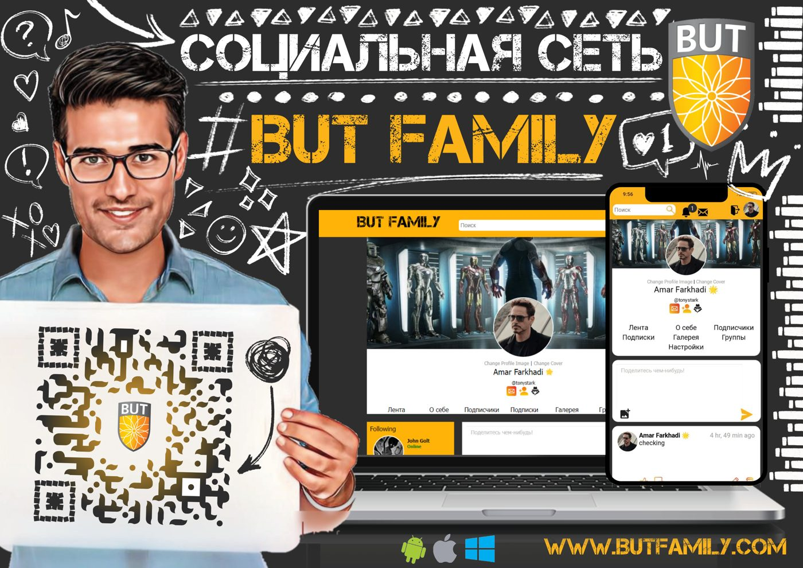
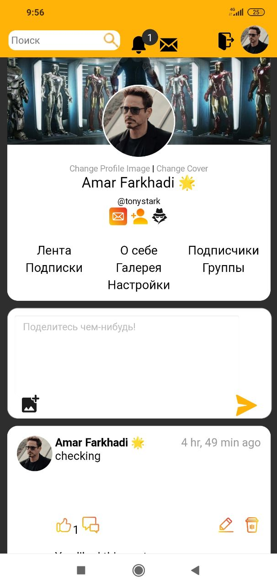
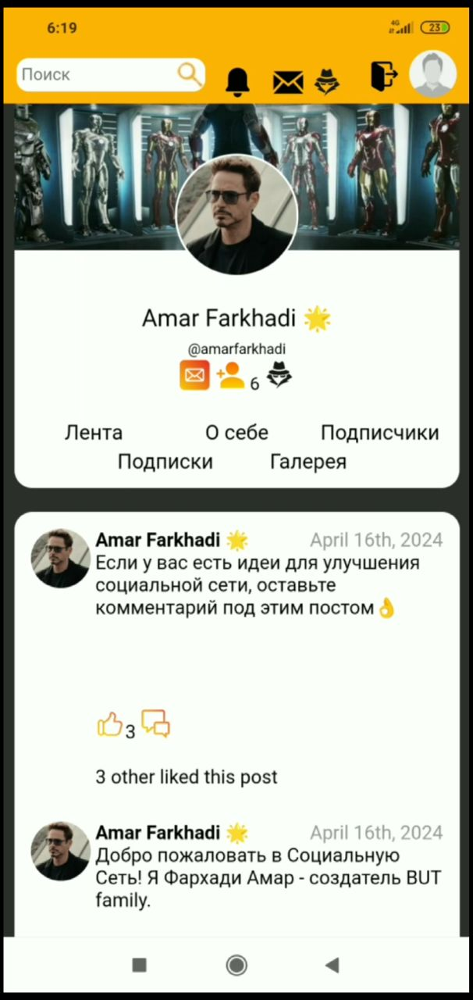
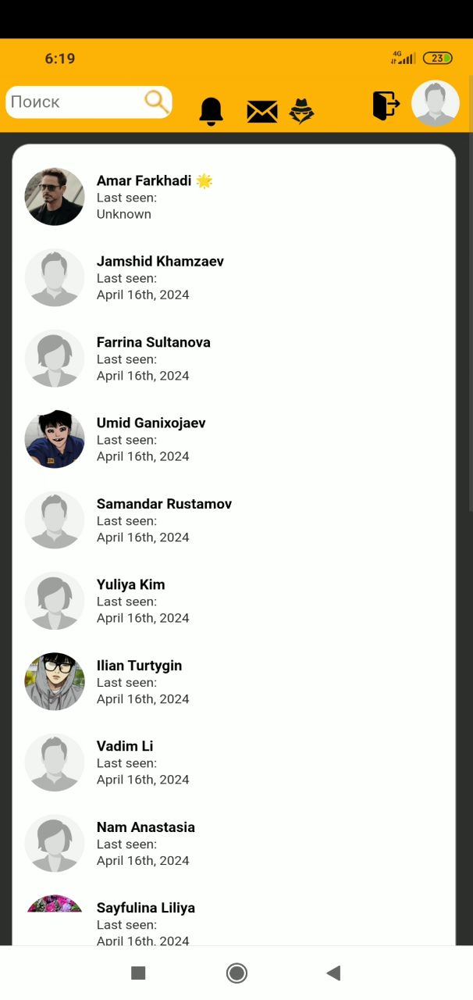

# BUT Family

A full social network for university students - posts, groups, direct messages, notifications,
follows - built from scratch in PHP and MySQL in 2024 for Bucheon University in Tashkent.



---

## Why this repository exists

**BUT Family failed.** It shipped complete and polished, users signed up, and adoption fell off
within a week.

I am publishing it anyway, because it taught me more than anything I built that worked. The product
was not the problem - the feed, the groups, the messaging and the notifications all worked. The
problem was that students already had Telegram, and nothing here was worth leaving it for. I built
for a year on the assumption that a dedicated campus network was wanted, and never tested that
assumption before writing the code.

Execution cannot rescue a product nobody needs. That is the whole lesson, and it cost a year to
learn properly.

## What it does

| | |
|---|---|
| **Feed** | Posts with images, likes, threaded comments |
| **Profiles** | Avatar, bio, photo gallery, followers / following, per-user settings |
| **Groups** | Create, invite, join requests, member management, group photo albums, per-group settings |
| **Messaging** | Direct message threads between users |
| **Notifications** | Likes, comments, follows, group invites and requests |
| **Search** | Find users and groups |
| **Auth** | Registration, login, session handling |

<p align="center">
  
  
</p>



## Stack

Deliberately plain, no framework:

- **PHP** with `mysqli`, organised into a small `classes/` layer (`connect`, `login`, `signup`,
  `settings`, `functions`)
- **MySQL** for everything
- **jQuery + AJAX** in `ajax/` for likes, comments and notifications without page reloads
- **Hand-written CSS** with separate `adaptive.css` / `home_adaptive.css` for mobile
- **EmojiOneArea** for the emoji picker

The `_content_` file naming (`profile_content_followers.php`, `group_content_members.php`) is a
poor man's component system: each tab of a profile or group is its own partial, included by the
parent page based on the active tab.

## Running it locally

Requires PHP 7.4+, MySQL and a web server. XAMPP or MAMP is the fastest route.

```bash
git clone https://github.com/starboyqwerty/but-family
```

1. Drop the folder into your web root (`htdocs/`).
2. Create a MySQL database - `but_db` by default.
3. Copy the config and set your credentials:

   ```bash
   cp .env.example .env
   ```

   ```
   DB_HOST=localhost
   DB_USER=root
   DB_PASSWORD=
   DB_NAME=but_db
   ```

   Credentials are read via `getenv()` in `classes/connect.php`, falling back to standard local
   values, so nothing secret is committed.

4. Make sure `uploads/` is writable by the web server.
5. Open it in your browser and register an account.

> **Note:** the schema is not included in this repository. It was reconstructed live during
> development rather than kept in migrations - which is itself a mistake worth not repeating.

## A note on data

`uploads/` in this repository is empty, and `*.db` / `*.sql` are gitignored. The production
instance held real photos and messages from real students; none of that is here, and it should
stay that way in any fork.

## License

MIT - see [LICENSE](LICENSE).

---

Built by [Amar Farkhadi](https://amar-farkhadi.vercel.app/)
